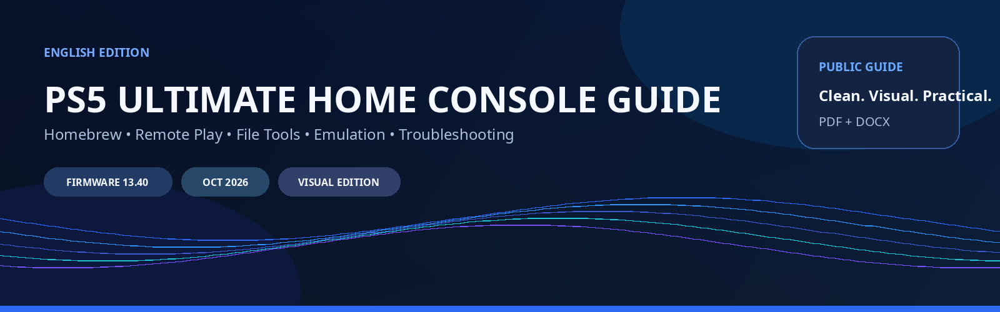
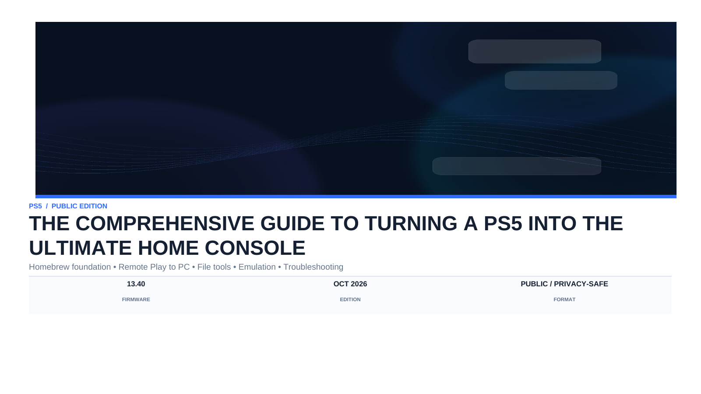
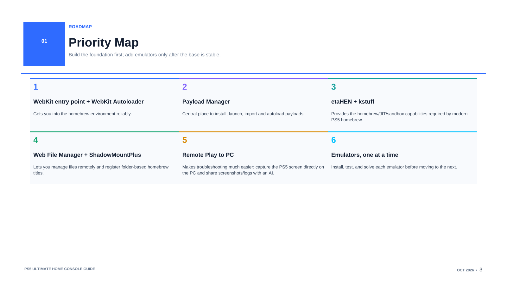
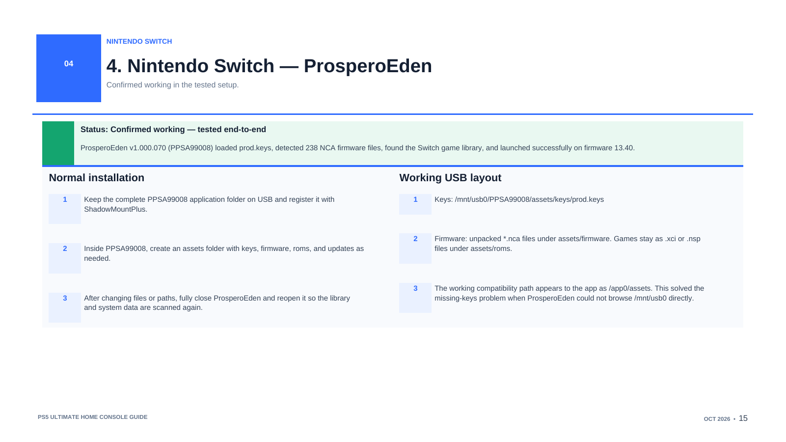
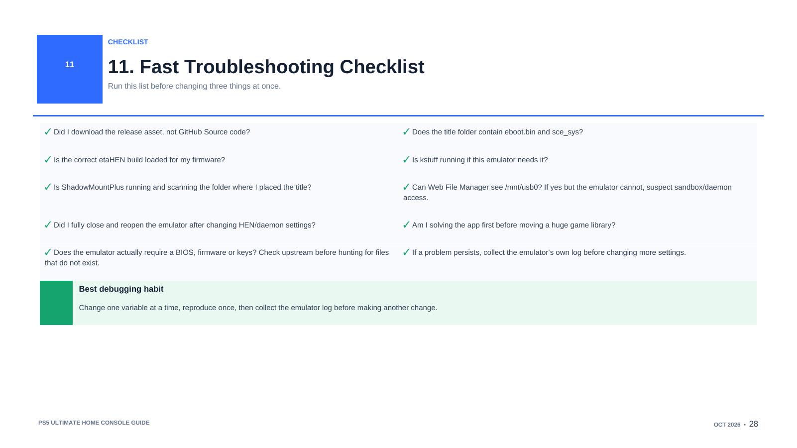

  

  
  
  
  
  

<strong>A visual, beginner-friendly PS5 homebrew and emulation guide built from a real firmware 13.40 setup.</strong>

  <a href="https://github.com/axxx503/PS5-Ultimate-Home-Console-Guide/releases/download/v1.5.4/PS5-Ultimate-Home-Console-Guide-EN-v1.5.4.pdf"><strong>PDF Guide v1.5.4</strong></a> ·
  <a href="https://github.com/axxx503/PS5-Ultimate-Home-Console-Guide/releases/download/v1.5.4/PS5_USB_Emulators_Source_Pack_v1.2.1.zip"><strong>USB Source Pack v1.2.1</strong></a> ·
  <a href="https://github.com/axxx503/PS5-Ultimate-Home-Console-Guide/releases/tag/v1.5.4">Release notes</a> ·
  <a href="https://github.com/axxx503/PS5-Ultimate-Home-Console-Guide-AR">Arabic project (currently unavailable)</a>

This **English Visual Edition** documents PS5 homebrew setup, emulator installation, original-disc experiments, PC streaming and practical troubleshooting. Results refer to specific builds and tests on firmware **13.40**; each page focuses on a task, decision or diagnostic step.

---

## Downloads

| Download | What it contains |
|---|---|
| **[PDF Guide — v1.5.4](https://github.com/axxx503/PS5-Ultimate-Home-Console-Guide/releases/download/v1.5.4/PS5-Ultimate-Home-Console-Guide-EN-v1.5.4.pdf)** | The complete 59-page reading edition, clickable contents and direct official links on relevant pages |
| **[USB Emulators Source Pack — v1.2.1](https://github.com/axxx503/PS5-Ultimate-Home-Console-Guide/releases/download/v1.5.4/PS5_USB_Emulators_Source_Pack_v1.2.1.zip)** | Companion source material, version-specific USB adaptations and technical notes; retains its independent version |
| **[SHA-256 checksums](https://github.com/axxx503/PS5-Ultimate-Home-Console-Guide/releases/download/v1.5.4/SHA256SUMS-v1.5.4-PDF-USB.txt)** | Published checksums for the PDF and USB source archive |

[View release v1.5.4](https://github.com/axxx503/PS5-Ultimate-Home-Console-Guide/releases/tag/v1.5.4). The updated editable Word edition is not available yet; older repository DOCX files are historical.

[What's new](#whats-new-in-v154) · [Compatibility](#emulator-compatibility) · [Installation](#homebrew--installation) · [Streaming](#pc-streaming--remote-play) · [Troubleshooting](#real-world-troubleshooting) · [Ownership & privacy](#ownership--privacy) · [Resources](#resources-credits--support)

## What's New in v1.5.4

- **Reading order:** setup and file tools precede installation; emulator chapters begin with RetroArch, then PS2 and PS3. Remote Play and PC streaming have separate sections.
- **Direct sources:** clickable project and documentation links appear on relevant PDF pages, alongside the full reference list.
- **RPCS3-5:** expanded original-disc setup, firmware/key configuration, FTP-versus-loader diagnosis and the distinction between application startup, disc detection and gameplay.
- **ProsperoLight:** PC-to-PS5 setup, Sunshine-compatible hosts, pairing, controls, video settings and troubleshooting, with the owner's demonstration linked below.
- **Practical fixes:** captured transfer failures and recovery steps are separated from owner-reported incidents, proposed checks and unresolved causes.
- **Ownership and privacy:** clearer guidance for personally owned media, AI-assisted troubleshooting and sanitized public examples.

### Start here

Read the preparation and privacy pages before changing a working setup. Back up saves and settings, confirm the exact firmware/application versions and review commands before running them. If using an AI assistant, describe the visible result and share only sanitized excerpts.

### PDF contents and navigation

| Part | Pages |
|---|---:|
| Cover, AI guidance, ownership, privacy and how to use the guide | 1–4 |
| Clickable contents | 5 |
| Homebrew foundation and file tools | 6–11 |
| Universal emulator installation rules | 12 |
| RetroArch and PSP | 13 |
| PlayStation 2 — PS5SX2 | 14–15 |
| PlayStation 3 — RPCS3-5 | 16–24 |
| GameCube and Wii — Porpoise | 25–26 |
| Wii U, 3DS and DS — PS5CEMU-HAR | 27–28 |
| Nintendo Switch — ProsperoEden | 29 |
| Original Xbox — XPSemu | 30–31 |
| Xbox 360 — PS5X360 | 32 |
| PS5 Remote Play — chiaki-ng | 33–36 |
| PC streaming — ProsperoLight | 37–47 |
| USB, storage, diagnostics and maintenance | 48–52 |
| Edition notes and release tables | 53–55 |
| References and project links | 56–59 |

Page numbers refer to the published v1.5.4 PDF. Older repository documents and images retain their historical context.

### Preview

<table>
<tr>
<td width="50%"></td>
<td width="50%"></td>
</tr>
<tr>
<td width="50%"></td>
<td width="50%"></td>
</tr>
</table>

Original repository previews are retained. They illustrate earlier editions; download the PDF for the current layout.

## Emulator Compatibility

These are the limits of the evidence recorded in v1.5.4, not a general compatibility rating. **Application launches** means startup; **game detected** means identification; **game boots** means reaching a game/menu; **playable** describes an actual play report. **Stable** requires sustained testing and is not established for every game here. **Developer-reported**, **not tested** and **unresolved** results remain distinct.

| Platform / emulator | Recorded result | Boundary / PDF pages |
|---|---|---|
| **RetroArch / PSP** | **Not tested** in this owner session. Storage and forwarder features are **developer-reported**. | No local compatibility result for beta 3; p. 13 |
| **PS2 — PS5SX2** | **Previously tested:** the earlier setup was recorded as working. | Current 2.10 build and PS2 DVD tiles were reviewed, not tested here; no all-game stability claim; pp. 14–15 |
| **PS3 — RPCS3-5** | **Verified:** app/helper startup and Sonic disc/key detection on Standard PS5 13.40. **Owner-reported playable:** Metal Gear Rising: Revengeance from an original disc. | Sonic gameplay, measured FPS, wider compatibility and sustained stability are not established; pp. 16–24 |
| **GameCube / Wii — Porpoise** | **Previously tested:** earlier project sessions recorded a working setup. | Porpoise 3.0 network, motion and graphics features are developer-reported; no universal game claim; pp. 25–26 |
| **Wii U / 3DS / DS — PS5CEMU-HAR** | **Game boots:** a 3DS title booted in the historical custom 3.0.0 USB build. | This does not establish Wii U/DS gameplay or a local test of current 4.0.1; pp. 27–28 |
| **Nintendo Switch — ProsperoEden** | **Game detected / boots:** v1.000.070 loaded system data, detected the library and recorded a successful launch on 13.40. | One recorded setup; sustained or all-game stability is not established; p. 29 |
| **Original Xbox — XPSemu** | **Unresolved:** earlier Otogi black-screen/no-frames result. | Alpha 2.1 improvements are developer-reported, not a successful retest; pp. 30–31 |
| **Xbox 360 — PS5X360** | **Game boots to title screen:** the earlier session reached Tenchu Z's title screen. | Gameplay/stability and current 0.6.0 behavior were not established by that result; p. 32 |

**Evidence labels:** `VERIFIED` = preserved technical evidence; `OWNER-REPORTED` = the owner's account; `UPSTREAM` = developer documentation; `PROPOSED` = a check or starting value not verified in this setup; `UNRESOLVED` = evidence does not establish the cause or outcome.

## Homebrew & Installation

| Tool | Role in the documented workflow |
|---|---|
| [WebKit Autoloader](https://github.com/itsPLK/ps5-webkit-autoloader) | Firmware-matching entry and payload-loading workflow |
| [Payload Manager](https://github.com/itsPLK/ps5-payload-manager) | Launch/manage supported payloads; the successful PS3 session used an existing 0.5.2 instance |
| [etaHEN](https://github.com/etaHEN/etaHEN) / [unified port](https://github.com/GronedWaffel/etahen-11.00-13.60) | Homebrew services in the recorded setup; match the build to the firmware |
| kstuff | Runtime support required by the relevant application/stack; follow exact release instructions |
| [ShadowMountPlus](https://github.com/drakmor/ShadowMountPlus) | Register complete homebrew title folders and expose supported storage mounts |
| [Web File Manager](https://github.com/owendswang/ps5-web-file-manager) | File transfer, management and raw readback; supported local launch functions |

Keep one known working stack. The PDF records a compatibility warning: ShadowMountPlus beta5/fix1 advises recent kstuff and no etaHEN; the observed mixed stack on one console is not a general recipe. FTP availability proves file transfer, not ELF-loader or emulator readiness.

See **PDF pp. 6–12** for setup/installation, **pp. 16–24** for RPCS3-5 and **pp. 48–52** for storage and maintenance. Use complete installable release folders, preserve writable data and avoid duplicate active copies of a title ID.

## PC Streaming & Remote Play

| Component | Role and direction |
|---|---|
| [ProsperoLight](https://github.com/blackbearreloaded/ProsperoLight) | Moonlight-compatible receiver on a modified PS5: **PC → PS5** |
| [Sunshine](https://github.com/LizardByte/Sunshine) / [Apollo](https://github.com/ClassicOldSong/Apollo) | PC host: renders/captures and sends the stream; host features vary |
| [chiaki-ng](https://chiaki-ng.github.io/chiaki-ng/) | PlayStation Remote Play receiver on a PC/device: **PS5 → PC/device** |

ProsperoLight receives video/audio and returns input; it does not execute Windows games locally on PS5. The PDF uses stable **01.000.110** as its documented baseline. No independent FPS, latency, HDR/VRR or multi-controller benchmark is claimed.

**[Watch: ProsperoLight on PS5 — Setup & Real-World Demonstration](https://youtu.be/kSxRmUBJnsM)**

This is the guide owner's video, not an official developer video. English viewers can check YouTube's subtitle, translation and audio-track options if available; published English dubbing is not assumed. See **PDF pp. 37–47** for streaming and **pp. 33–36** for Remote Play / ActRemoteLink.

## Real-World Troubleshooting

| Problem | Documented action and evidence | PDF |
|---|---|---|
| FTP works but PC access to port 9021 times out | Verified manual placement followed by local launch through the existing Payload Manager. The LAN timeout cause remains unresolved; FTP cannot replace runtime requirements. | 19, 22–23 |
| FTP readback stalls or directory rename returns 550 | Web File Manager raw HTTP readback verified the affected file hash; supported copy/move operations completed staging. | 23 |
| Web manager archive omits long filenames | Individually retrieved the 25 missing names via FTP, then verified the full 4,587-file manifest. | 23 |
| Library appears but PS3 firmware is missing | Install the official PS3 system software **inside RPCS3-5**. The prompt is owner-reported; later play was owner-confirmed. | 20, 22 |
| PS5 shell reports an unsupported PS3 disc | Check identification, matching key and library entry inside the emulator; shell rejection alone does not establish emulator compatibility. | 20–21, 51 |
| File manager sees USB but emulator cannot | Check the app's mounted namespace and exact release before moving a library or applying historical path patches. | 26, 28, 48–50 |

Record versions and a short reproduction, change one variable at a time and verify the actual result. Preserve saves, virtual HDDs, memory cards and working settings before repairs. Public support requests should contain sanitized excerpts, not raw device logs.

## Ownership & Privacy

The guide owner personally owns the consoles, games and original discs used in the documented experiments. System materials in those tests were obtained from owned hardware or legitimate sources. This project documents technical learning, emulation, preservation and interoperability; **it does not encourage piracy** or distribute pirated games or commercial system files for unauthorized use.

The author's original documentation, research and explanations remain distinct from third-party emulators, games, software and trademarks, which retain their respective ownership and licenses.

Use placeholders such as `<PS5_IP>`, `<PC_IP>`, `<USERNAME>` and `C:\Path\To\Project` in public examples. Do not publish real addresses, personal device/network names, account/device IDs, pairing material, system keys, personal paths or sensitive raw logs. Back up saves before account activation, save-association or storage changes. See **PDF pp. 2–4 and 24**.

## Resources, Credits & Support

### Referenced upstream projects

- [PS5 WebKit Autoloader](https://github.com/itsPLK/ps5-webkit-autoloader)
- [PS5 Payload Manager](https://github.com/itsPLK/ps5-payload-manager)
- [etaHEN](https://github.com/etaHEN/etaHEN)
- [etaHEN Unified 11.00-13.60](https://github.com/GronedWaffel/etahen-11.00-13.60)
- [ShadowMountPlus](https://github.com/jakovasaur/ShadowMountPlus)
- [ActRemoteLink](https://github.com/francoataffarel/ActRemoteLink)
- [chiaki-ng](https://chiaki-ng.github.io/chiaki-ng/)
- [ProsperoEden](https://github.com/A1vinSmith/prosperoeden)
- [PS5SX2](https://github.com/Swordpdf/PS5SX2)
- [Porpoise](https://github.com/elripalda/Porpoise-Dolphin-Emulator-for-PS5)
- [PS5CEMU-HAR](https://github.com/premohq/PS5CEMU-HAR)
- [PS5X360](https://github.com/BrinooTk/PS5X360)
- [XPSemu](https://github.com/ZiZc3/XPSemu)
- [PS5 RetroArch](https://github.com/mihawk-99/PS5_RetroArch)
- [GoldHEN](https://github.com/GoldHEN/GoldHEN) — referenced only to clarify that it is a PS4 project
- [ShadowMountPlus — release source cited in v1.5.4](https://github.com/drakmor/ShadowMountPlus)
- [Web File Manager](https://github.com/owendswang/ps5-web-file-manager)
- [RPCS3-5 1.2.2 Beta](https://github.com/owenksmith24-tech/RPCS3-PS5-Port-Build-/releases/tag/Release-1.2.2-Beta)
- [KB-RPCS3](https://github.com/kamb205/KB-RPCS3)
- [ProsperoLight](https://github.com/blackbearreloaded/ProsperoLight)
- [Sunshine](https://github.com/LizardByte/Sunshine)
- [Apollo](https://github.com/ClassicOldSong/Apollo)

Thanks to the original developers, maintainers, testers and contributors. Project links provide attribution; inclusion does not imply affiliation or ownership of their work. The original ShadowMountPlus link above is retained as a historical reference; follow the source cited by the PDF for its reviewed build.

### Historical notes and project tools

The v1.3.0 update added the ProsperoEden record: title `PPSA99008`, build `v1.000.070`, system-key detection, 238 NCA firmware files and a detected/launched game. The USB `assets` layout was exposed as `/app0/assets`. These are specific historical observations, not universal compatibility results.

[**Historical USB runbook**](docs/USB-READ-ME.md) · [**ProsperoEden session guide**](docs/reference/ProsperoEden-PS5-Complete-Guide-AR.pdf) · [**Repository USB source notes**](tools/usb-source-pack/) · [**PC release tracker**](tools/release-tracker/)

The companion pack retains historical build targets: only the custom CEMU/3DS source build was reproduced in the earlier work. Experimental Porpoise/XPSemu adaptations do not become verified builds or apply automatically to newer releases. See **PDF pp. 48–49** and the archive's own notes. The repository tools/documents may predate v1.5.4; the published PDF is the current reading reference.

### Corrections and contributions

Found an outdated path, changed release behavior, or a better upstream source? Open an issue using the correction template. Include the **page/section**, **firmware**, **project version**, and a link to the relevant upstream documentation when possible.

See [CONTRIBUTING.md](CONTRIBUTING.md) before submitting a pull request.

### Versioning

Current reading edition: **v1.5.4**, published **19 October 2026**. Use the [release notes](https://github.com/axxx503/PS5-Ultimate-Home-Console-Guide/releases/tag/v1.5.4) for this edition; [CHANGELOG.md](CHANGELOG.md) retains repository history. Technical source reviews in the PDF are dated 18 October 2026. The USB source pack remains **v1.2.1**.

### License

Guide text and original visual layout are released under **CC BY-NC-SA 4.0**. Third-party names, trademarks, software, and linked materials retain their own licenses and ownership. See [LICENSE](LICENSE) and [NOTICE.md](NOTICE.md).

### Support

If this guide saved you time and you want to support future documentation and localization work: [Buy Me a Coffee](https://buymeacoffee.com/axxx503).

---

Not affiliated with Sony Interactive Entertainment or any referenced homebrew/emulator project.

